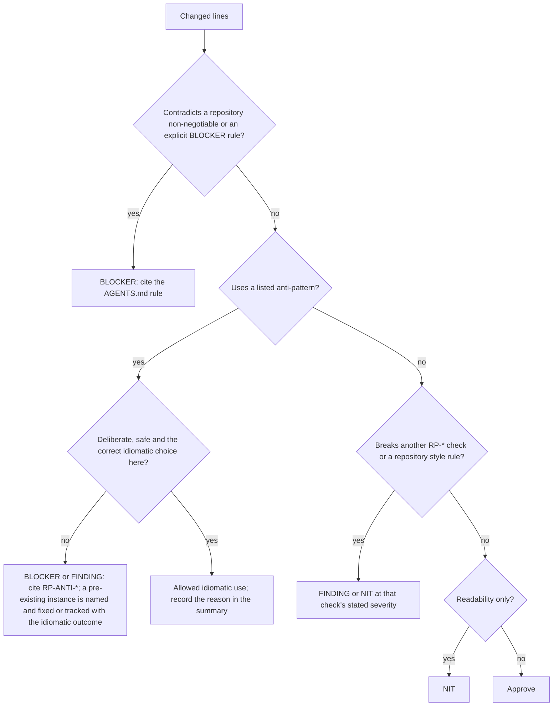

<!-- SPDX-License-Identifier: MIT-0 -->

# Rust idioms and patterns review guide

> A review gate for the Rust Design Patterns book's idioms, design patterns and
> anti-patterns, applicable to any Rust repository.

This guide turns the book's [Idioms](https://rust-unofficial.github.io/patterns/idioms/),
[Design Patterns](https://rust-unofficial.github.io/patterns/patterns/index.html) and
[Anti-patterns](https://rust-unofficial.github.io/patterns/anti_patterns/index.html)
chapters into checks a reviewer applies to Rust changes. It is narrower than the book on
purpose: the Functional Programming and Additional Resources chapters are reference
material, not review gates.

This is a pure Rust guide. It records Rust idioms, patterns and anti-patterns, not
repository-specific rulings. Repository rules live in [AGENTS.md](../AGENTS.md) and
are cited from there; this guide must never be edited to store them.

The book's examples use `panic!`, `unwrap`, `unsafe` and `f64` freely because they
illustrate a shape, not a production contract. Do not copy them without applying the
repository's own rules and the checks below. This copy governs `exchange-hours`; its review
obligation is carried by **LAW-IDIOMS** in AGENTS.md.

## How to use this guide

1. Review the lines the change adds or materially rewrites. A reviewer also names every
   pre-existing anti-pattern or non-idiomatic idiom the change exposes — inline where it
   is in the diff, in the review summary where it is outside it — so it is fixed or
   opened as a tracked issue (LAW-IDIOMS). Naming it never widens the PR. An existing
   instance is not precedent: a tracked issue records the idiomatic fix, never
   permission to keep or repeat the pattern.
2. Check the repository contract first. A non-negotiable violation is a BLOCKER and ends
   the idiom discussion; other rules keep the severity this guide or the repository
   contract states.
3. Then check the anti-patterns in [Anti-patterns](#anti-patterns). They are the cheapest
   place to catch a wrong borrow-checker fix or a hidden invariant bypass.
4. Then check the idioms in [Idioms](#idioms) and the patterns in
   [Design patterns](#design-patterns). A pattern is not required merely because the
   book names it (RP-PAT-YAGNI).
5. Every comment carries the check ID, `file:line`, the required outcome and the
   severity. Where a repository rule applies, cite its rule ID as well. The review
   thread is where a deviation's reason is recorded; do not ask for a code comment that
   cites this guide or the book.
6. Every review conversation — inline, including outdated threads, and recommendations
   outside the diff in review-summary comments — receives an explicit disposition and is
   resolved before merge. AI-authored GitHub posts follow the repository's attribution
   rule and name the exact model identifier.

CI already runs formatting, linting, tests, doctests, rustdoc and dependency checks. Do
not reproduce a compiler or Clippy diagnostic as a review finding; use those tools for
the mechanics. This guide covers the judgments a compiler cannot make: whether a clone
duplicated authoritative state, whether a pattern is earning its keep, whether a `Deref`
impl exposes an invariant.

| Severity | Means | Disposition |
| --- | --- | --- |
| BLOCKER | Breaks a repository non-negotiable, risks money or account state, creates undefined behaviour or unapproved unsafe code, or hides a required failure | Must be fixed before merge |
| FINDING | Correct code that is non-idiomatic, over-abstracted, fails to use a safer idiom, or duplicates expense without need | Fix it, or resolve the thread with the recorded reason |
| NIT | Naming, placement or readability with no behavioural consequence | Optional; resolve either way |

The shape of a finding (paths are illustrative):

> **RP-ANTI-CLONE (BLOCKER)** — `src/orders.rs:42`: the fill is applied to
> `book.order.clone()`, so the live order keeps the old quantity while the code reports
> a fill. Apply it through the order owner (`&mut`) and return the updated state.
> Book: [Clone to satisfy the borrow checker](https://rust-unofficial.github.io/patterns/anti_patterns/borrow_clone.html).

## Idioms

An idiom check is a default. Deviate only when the alternative is demonstrably worse for
this code, and record the reason in the PR or review thread. The checks are grouped so a
reviewer can work through a diff once.

### Borrowed types for arguments (RP-IDIOM-BORROW)

**Enforce.** A parameter takes the borrowed view, not a borrow of an owned container:
`&str` over `&String`, `&[T]` over `&Vec<T>`, `&T` over `&Box<T>`, `&Path` over
`&PathBuf`, `&OsStr` over `&OsString`. This removes a layer of indirection and accepts
more callers (including literals and slices). Take ownership only when the callee stores
the value, consumes it or needs its capacity; do not add a generic `impl AsRef` unless
several borrowed forms are genuinely needed (RP-PAT-YAGNI).

**Red flags.** `&String`, `&Vec<`, `&Box<` or `&PathBuf` in a signature; cloning inside a
function only to pass a reference; a generic function whose only use is one `&str` call
site. Clippy's `ptr_arg` catches the mechanical cases; review catches the API shape.

**Outcome.** FINDING on a public or cross-module signature; NIT on a private helper.

Book: [Use borrowed types for arguments](https://rust-unofficial.github.io/patterns/idioms/coercion-arguments.html).

### Concatenating strings with `format!` (RP-IDIOM-FORMAT)

**Enforce.** Use `format!` with inline captures for a mix of literal and interpolated
text; it is usually the most readable form. Use `push_str`/`push` with a preallocated
buffer, or `write!` into a reused buffer, for loops and hot paths where repeated
allocation matters. Prefer `format!` over a chain of `+` on owned strings unless the
chain is clearly simpler.

**Red flags.** `String::from("...") + &name` chains; `format!` inside a per-tick or
per-order loop; a `format!` whose only consumer is logging, where structured fields are
cheaper and are the tracing form.

**Outcome.** NIT for readability; FINDING when allocation appears on a hot path without
evidence that it is acceptable.

Book: [Concatenating strings with format!](https://rust-unofficial.github.io/patterns/idioms/concat-format.html).

### Constructors (RP-IDIOM-CTOR)

**Enforce.** Rust's constructor is an associated function, conventionally `new`.
`new` validates every invariant the type promises and is fallible (`Result<Self,
TypedError>`) when validation can fail; an infallible `new` is only for types that cannot
be invalid. Name additional constructors for their meaning (`from_venue`,
`try_from_row`), implement `From`/`TryFrom` where the conversion is conventional, and
implement `Default` only when the default value is semantically valid
(RP-IDIOM-DEFAULT). Multiple optional arguments are the signal for a builder
(RP-PAT-BUILDER), not a long positional parameter list. When the primary constructor
takes no arguments, implement `Default` as well (the book's convention; Clippy's
`new_without_default` enforces it under `-D warnings`); if a valid default cannot exist,
do not offer an empty `new` either.

**Red flags.** `pub fn new` returning `Self` while unwrapping, panicking or silently
clamping (a panic is never an error path; clamping additionally breaks exact-value or
invariant rules); public fields that let callers bypass the validation a constructor
performs; a public constructor on a type whose contract requires a factory or builder;
an error path that returns an opaque `Box<dyn Error>` instead of a typed error.

**Outcome.** FINDING for the constructor shape or a weak validation boundary; BLOCKER
when it panics, bypasses an invariant the type claims, or bypasses a required factory or
builder.

Book: [Constructors](https://rust-unofficial.github.io/patterns/idioms/ctor.html).

### The `Default` trait (RP-IDIOM-DEFAULT)

**Enforce.** Derive `Default` when every field's default is meaningful and safe, and use
`..Default::default()` for configuration and test fixtures. It must not stand in for
state the code does not have: an absent instrument, account, id or side, or a zero or
`None` used as a sentinel for required data, is fabricated business state, not a default.
`Default` has no error channel, so a type whose invariant needs fallible validation does
not implement it; `Default` exists only where a valid value needs no fallible input.

**Red flags.** `#[derive(Default)]` on domain types such as instruments, orders,
positions, secrets or identifiers; `Default` used to recover from a failed
initialization; a builder or credential type whose derive produces an insecure default;
`unwrap_or_default()` where the missing value should be an error.

**Outcome.** BLOCKER when it fabricates or hides domain state; FINDING when the default
is semantically questionable but contained.

Book: [The Default trait](https://rust-unofficial.github.io/patterns/idioms/default.html).

### Collections are smart pointers (RP-IDIOM-DEREF)

**Enforce.** Implement `Deref` only where the type is pointer-like and dereferencing
yields its borrowed view: a smart pointer, a guard, or a collection wrapper exposing
`[T]`, `str` or another borrowed form. The target must be the same data, not an
unrelated inner type (RP-ANTI-DEREF). Prefer explicit accessors (`as_slice`, `as_str`,
`inner`) where the relationship is not pointer-like. A newtype that exists to enforce an
invariant must not implement `DerefMut`; shared `Deref` is acceptable only when reading
the inner view cannot break the invariant.

**Red flags.** `impl Deref` on a wrapper that is not pointer-like, where the target
exists only to lend its methods; `DerefMut` on a validated wrapper; a `Deref` added so
callers can reach inner methods; `Deref` on a secret or credential type.

**Outcome.** FINDING; BLOCKER when it exposes a secret or provides a construction or
mutation path that bypasses validation (`DerefMut`, an infallible `From<Inner>`, a
mutable accessor). A shared read-only view cannot break the invariant by itself.

Book: [Collections are smart pointers](https://rust-unofficial.github.io/patterns/idioms/deref.html).

### Finalisation in destructors (RP-IDIOM-DROP)

**Enforce.** Use an RAII guard for cleanup that must happen on every normal exit,
including `?` returns: bind the guard to a named variable (never `_`), keep it a value
or unique owner, and make its `Drop` panic-free. If the shipped binary uses
`panic = "abort"`, a panic does not unwind and `Drop` does not run on it; `Drop` is
cleanup on scope exit, not a durability guarantee. State that must survive a crash
belongs in persisted state plus startup reconciliation, not in a destructor.

**Red flags.** The same cleanup repeated in several error paths that a guard would
cover; `let _ = guard` dropping immediately; a guard moved or stored beyond its
resource's lifetime; a `Drop` that blocks, panics or performs fallible I/O whose failure
is silently discarded; cleanup whose loss would leave orders, positions or sessions in a
wrong state.

**Outcome.** FINDING for missing RAII cleanup; BLOCKER when durability or order-state
correctness is assumed from `Drop`, or when `Drop` can panic.

Book: [Finalisation in destructors](https://rust-unofficial.github.io/patterns/idioms/dtor-finally.html)
and [RAII guards](https://rust-unofficial.github.io/patterns/patterns/behavioural/RAII.html).

### `mem::{take, replace}` for owned values in changed enums (RP-IDIOM-MEM)

**Enforce.** Use `mem::take`, `Option::take` or `mem::replace` to move a value out of a
`&mut` when changing an enum or state machine, instead of cloning. The replacement is a
valid, inert placeholder; it must not become observable as real state if later work
fails or the future is cancelled. If the placeholder could leak through `?`, an error
path or an async cancellation point, restructure the transition: replace the value back
before an error return, and for an await either restore it in a `Drop` guard or do not
await while the placeholder is live (a cancelled future never returns). Use
`mem::replace` when the type has no `Default`.

**Red flags.** `.clone()` inside a state-transition match; `mem::take` followed by
fallible work and `?` with no restore; `Option::take` on a field the caller must later
assume is populated; a default placeholder that collides with a real value (empty id,
zero sequence, default instrument).

**Outcome.** FINDING for a clone that the idiom replaces; BLOCKER when an error or
cancellation path leaves observable default state.

Book: [`mem::{take, replace}`](https://rust-unofficial.github.io/patterns/idioms/mem-replace.html).

### On-stack dynamic dispatch (RP-IDIOM-DYN)

**Enforce.** When a branch selects between differently typed values and only trait
methods are used afterwards, bind a `&dyn Trait` or `&mut dyn Trait` in one `let`
instead of boxing. Modern Rust extends temporary lifetimes, so the boxed form is
unnecessary at a cold boundary. Keep static dispatch for hot paths unless heterogeneous
runtime choice requires `dyn`, and prefer an enum when the set of variants is closed and
known.

**Red flags.** `Box<dyn Trait>` created solely to unify two branches in a cold path;
`dyn` on a market-data or order path without a measured reason; `dyn` with a single
implementation (RP-PAT-YAGNI); a boxed trait object where an enum with exhaustive
matching would preserve domain invariant checking.

**Outcome.** NIT or FINDING; performance-sensitive dispatch without justification is a
FINDING.

Book: [On-stack dynamic dispatch](https://rust-unofficial.github.io/patterns/idioms/on-stack-dyn-dispatch.html).

### Iterating over an `Option` (RP-IDIOM-OPTION)

**Enforce.** Treat `Option` as a zero-or-one container when the surrounding code is
iterator-shaped: `extend`, `chain`, `flatten`, `std::iter::once` for the always-present
case. Prefer `if let` when a plain branch is clearer. `Option` is not an error type:
absence that violates the operation's contract is a typed error, and a `None` branch
must not silently skip required work.

**Red flags.** `for value in option` used purely for side effects where `if let` reads
better; `option.into_iter().flatten()` where `Option::flatten` is the clearer
`Option<Option<T>>` form; `filter_map` quietly dropping rows that should fail parsing;
`unwrap_or_default()` standing in for a required value.

**Outcome.** NIT for shape; FINDING or BLOCKER when the Option path hides a required
failure.

Book: [Iterating over an Option](https://rust-unofficial.github.io/patterns/idioms/option-iter.html).

### Passing variables to a closure (RP-IDIOM-CLOSURE)

**Enforce.** When a closure needs a mixture of moves, clones and borrows, rebind the
variables in a block immediately before the closure so the capture intent is explicit
and values the closure does not need drop promptly. Prefer `move` with named captures in
spawned tasks and async blocks. Clone only the handles the closure genuinely shares
(`Arc` for shared ownership); do not clone to appease the borrow checker
(RP-ANTI-CLONE).

**Red flags.** A `move` closure capturing `self` or a whole `Arc` when it needs one
field; pre-cloned variables used once, far from the closure; a closure holding a lock
guard or credential across an `await`; capture lists that make the closure's lifetime
requirements hard to see.

**Outcome.** NIT for shape; FINDING when a capture extends a lock, secret or large
allocation beyond its necessary scope.

Book: [Pass variables to closure](https://rust-unofficial.github.io/patterns/idioms/pass-var-to-closure.html).

### Privacy for extensibility (RP-IDIOM-PRIVACY)

**Enforce.** Private fields prevent direct construction and exhaustive matching, which is
how a type keeps its construction invariants; here they also carry the validation.
`#[non_exhaustive]` applies across the defining crate boundary and exists for genuinely
open sets whose variants or fields can grow outside it. The book uses both for
compatibility; a pre-release project may reshape its own formats in place instead. Use
`#[non_exhaustive]` where the type genuinely models an open external set; speculative
future-proofing, private sentinel fields or wildcard-tolerant parsing for the project's
own future fields is YAGNI (RP-PAT-YAGNI).

**Red flags.** `#[non_exhaustive]` on an internal type for hypothetical evolution; a
private `_field: ()` added only to force `..` patterns; a wildcard arm on an enum we own
that swallows a variant instead of handling it; a wildcard that returns a default,
`None`, `Ok(())` or a log-only path where the unknown case is a real failure.

**Outcome.** FINDING for speculative future-proofing; BLOCKER when a wildcard hides a
required outcome or fabricates one, or when the change adds compatibility machinery the
repository contract forbids.

Book: [`#[non_exhaustive]` and private fields](https://rust-unofficial.github.io/patterns/idioms/priv-extend.html).

### Easy doc initialization (RP-IDIOM-DOCS)

**Enforce.** A rustdoc example compiles and, where it claims behaviour, runs and asserts
it; CI runs doc examples as tests. Use a helper function inside the example to avoid
setup boilerplate, but assertions inside a helper that is never called do not run; when
the assertion matters, use a working example or a `#[doc(hidden)]` construction helper
that the doctest calls. `no_run` is acceptable only for an example that claims no
behaviour or needs a real external boundary, with the reason stated; `ignore` does not
compile and is not acceptable for a public item's example. Doc examples are public
teaching material: they must not model `unwrap`, `panic!`, `f64` money or unsafe code.

**Red flags.** A helper-wrapped example whose assertions never execute; `no_run` or
`ignore` used to dodge behaviour; copied book examples containing panic-family calls or
`f32`/`f64` financial arithmetic; missing `# Errors`/`# Panics` sections on public
fallible items.

**Outcome.** A doctest that fails to compile or run is a CI failure, not a review
severity; a doctest that teaches a forbidden idiom or drops the assertion it claims is a
FINDING.

Book: [Easy doc initialization](https://rust-unofficial.github.io/patterns/idioms/rustdoc-init.html).

### Temporary mutability (RP-IDIOM-MUT)

**Enforce.** Keep `mut` scoped to the preparation step and rebind the value immutable
before it is read, either in a nested block or with `let data = data;`. The compiler then
prevents accidental mutation after processing. This is the default shape for sorting,
normalizing or assembling data before it becomes read-only.

**Red flags.** A long-lived `mut` binding mutated once; mutation after the value starts
being shared; unnecessary `mut` in tests or helpers (Clippy catches the mechanical
case).

**Outcome.** NIT.

Book: [Temporary mutability](https://rust-unofficial.github.io/patterns/idioms/temporary-mutability.html).

### Return the consumed argument on error (RP-IDIOM-ERROR-ARG)

**Enforce.** A fallible function that consumes a value it may fail to use should return
that value inside its typed error so the caller can retry or recover without cloning
(for example, `String::from_utf8` returns a `FromUtf8Error` whose `into_bytes` recovers
the input). Apply it by default to every consumed argument; retry or recovery is the
motivation, and when a borrow suffices, do not force ownership. If the returned value is
a secret, the error type must keep it redacted in `Debug` and zeroized on drop.

**Red flags.** A retry loop cloning its input on every attempt; a send/parse API that
consumes a value and discards it on error although the caller must retry; an error type
that derives `Debug` or `Clone` over secret material.

**Outcome.** NIT or FINDING, and BLOCKER for a secret leaked through an error's
`Debug` or a non-zeroizing error payload.

Book: [Return consumed arg on error](https://rust-unofficial.github.io/patterns/idioms/return-consumed-arg-on-error.html).

### FFI idioms (RP-IDIOM-FFI)

**First check.** Unsafe code requires the repository contract's explicit approval.
Without an operator-approved exception covering the unsafe code and its lint exception,
any new `unsafe` code (including an `unsafe extern` declaration), raw-pointer FFI
boundary or unsafe-lint weakening is a BLOCKER. Approval of a feature is not approval of
unsafe code. Where severe safety rules forbid unsafe entirely, these FFI checks explain
why the boundary stays out of the repository.

**Enforce, when approved.** Keep the foreign string borrowed and convert with `CStr` and
`to_str`, rather than copying bytes by hand. For outbound strings, bind the `CString` so
it lives until the foreign code has finished with it; a temporary
`CString::new(...)?.as_ptr()` argument is valid for the duration of the call, but not if
the callee stores the pointer or the value must outlive the statement. If the foreign
code may modify the bytes, use `Vec<u8>` instead of `CString`, and do not transfer string
ownership unless the foreign API requires it. Flat error enums become integer codes,
structured errors become a code plus a message, and a custom Rust error type becomes a
transparent `#[repr(C)]` mirror before it crosses; the native Rust error type stays
inside. Document every null, sentinel and ownership contract, keep `unsafe` blocks
minimal with a `// SAFETY:` justification, and expose a safe facade where possible.

**Red flags.** Any unsafe code without explicit approval; a panic, `unwrap`, `expect`,
arithmetic that can overflow or allocation failure reachable from an `extern "C"`
function (if the binary aborts on panic, a panic kills the process; `catch_unwind` is not
error handling); heap memory whose owner is unspecified; `#[repr(Rust)]` types crossing
the ABI; a lifetime hidden in a pointer without a documented contract.

**Outcome.** BLOCKER for unapproved unsafe or FFI; otherwise FINDING for a boundary that
does not follow the ownership, string and error idioms.

Book: [FFI idioms](https://rust-unofficial.github.io/patterns/idioms/ffi/intro.html),
[Idiomatic errors](https://rust-unofficial.github.io/patterns/idioms/ffi/errors.html),
[Accepting strings](https://rust-unofficial.github.io/patterns/idioms/ffi/accepting-strings.html),
and [Passing strings](https://rust-unofficial.github.io/patterns/idioms/ffi/passing-strings.html).

## Design patterns

A pattern enters the code only to solve a problem the change actually has. Rust already
replaces many of the book's patterns with a language feature, and speculative abstraction
is expensive. Review the pattern's present use, not its possible future.

### YAGNI and pattern selection (RP-PAT-YAGNI)

**Enforce.** Ask three questions before accepting an abstraction: what present problem
does it solve, how many real call sites or implementations does it have today, and what
is the simpler Rust form (enum plus `match`, a function, a closure, a trait, an
iterator)? A pattern with one implementation is speculative unless it is a boundary the
composition root needs for dependency inversion or test substitution. Importing an
object-oriented pattern wholesale is a FINDING: traits, enums and closures usually
replace inheritance, strategy objects and visitor dispatch.

**Outcome.** FINDING for speculative structure; NIT for a clearer name or placement;
BLOCKER only where the structure creates a contract violation.

Book: [YAGNI](https://rust-unofficial.github.io/patterns/patterns/index.html#yagni).

### Behavioural patterns

#### Command (RP-PAT-COMMAND)

**Use when.** Actions must be queued, deferred, replayed, undone or dispatched
heterogeneously after an event. Use a closed enum plus `match` when the command set is
ours and fixed; use a trait object when the set is open or extended by a plugin; use
plain functions or closures when a command is one small operation.

**Review.** Undo must restore the real prior state, not an approximation; every command
returns a typed error and never panics on an invalid transition; a command object must
not hold a lock or secret across an `await`; dynamic dispatch on the order path needs a
measured reason. A command that submits to an execution adapter surfaces the typed
result; an order submission assigned to `_` is a FINDING and, when a failure would be
invisible to the operator, a BLOCKER.

**Outcome.** NIT or FINDING; a command that reports success after a failed side effect is
a BLOCKER.

Book: [Command](https://rust-unofficial.github.io/patterns/patterns/behavioural/command.html).

#### Interpreter (RP-PAT-INTERPRETER)

**Use when.** A genuinely recurring mini-language needs interpreting (filters, strategy
rules, expressions) and the grammar is small enough to own. A one-off expression is not
a language.

**Review.** The parser and interpreter return typed errors; they never panic on malformed
input. Reject the book's panicking parser example. Keep the interpreted vocabulary in
domain types, cap resource use for untrusted input, and prefer `macro_rules!` when the
language is compile-time syntax rather than runtime data. Do not build a DSL to avoid
one function call (RP-PAT-YAGNI).

**Outcome.** FINDING for an unnecessary interpreter; BLOCKER for panic-based error
handling or unbounded execution.

Book: [Interpreter](https://rust-unofficial.github.io/patterns/patterns/behavioural/interpreter.html).

#### Newtype (RP-PAT-NEWTYPE)

**Use when.** A value needs distinguishable units or identity (an instrument root, a
client order id, a validated symbol, a quantity increment), an invariant that must hold
at every use, or abstraction that hides implementation types while controlling the
interface (the book's primary motivation). The private field plus fallible constructor
is the default shape.

**Review.** A newtype that carries an invariant or makes a distinction validates through
its constructors; a `DerefMut`, an infallible `From<Inner>` that skips validation or a
public mutable accessor defeats it (RP-ANTI-DEREF). Shared read-only `Deref` does not
construct or mutate the wrapper, so judge it as ergonomics, not as a bypass. Implement
only the traits whose meaning survives the wrapper; `Debug`/`Display` for secrets must
redact. A newtype that adds no distinction, abstraction or invariant is boilerplate
(RP-PAT-YAGNI). Zero-cost is a benefit, not a reason to wrap every primitive.

**Outcome.** FINDING for a bypassing conversion or a valueless wrapper; BLOCKER when the
wrapper exists to protect money, identity or secret invariants and exposes them anyway.

Book: [Newtype](https://rust-unofficial.github.io/patterns/patterns/behavioural/newtype.html).

#### RAII guards (RP-PAT-RAII)

**Use when.** A resource or state must be released or finalised on every normal exit:
locks, sessions, subscriptions, scoped instrumentation, temporary state. The guard
mediates access and its `Drop` performs the release.

**Review.** The guard is held for the full critical section and not cloned or forgotten
(`let _ =`). A blocking guard (`std::sync`) is not held across an `await`; an async-aware
guard may be, if its deadlock and lock-order consequences are understood. `Drop` must not
panic and must not block; it does not provide durability across a panic or process death
because the shipped binary aborts (RP-IDIOM-DROP). Access to the guarded value through a
`Deref` guard is the legitimate Deref case (RP-IDIOM-DEREF).

**Outcome.** BLOCKER for a blocking guard held across an `await`, a panicking `Drop`, a
guard whose loss corrupts order/account state, or an unaddressed deadlock; FINDING
otherwise.

Book: [RAII guards](https://rust-unofficial.github.io/patterns/patterns/behavioural/RAII.html).

#### Strategy (RP-PAT-STRATEGY)

**Use when.** A caller or runtime configuration selects one of several algorithms behind
one contract. Rust's trait is the strategy interface; closures are the strategy for a
single operation. Use a generic parameter for static dispatch where the implementation is
known at the call site, and a trait object only where heterogeneous choices are stored or
selected at runtime.

**Review.** A strategy trait with one implementation and no planned second is YAGNI; a
trait object on a hot path needs a measured reason; a `bool` or enum switch that selects
behaviour once should usually be a `match`, not an object graph. Where the repository
contract defines a provider or service boundary, use that trait rather than inventing a
parallel strategy trait. Do not hide a required failure behind the indirection.

**Outcome.** NIT or FINDING; BLOCKER if the indirection hides a required failure or
breaks the repository boundary rule.

Book: [Strategy](https://rust-unofficial.github.io/patterns/patterns/behavioural/strategy.html).

#### Visitor (RP-PAT-VISITOR)

**Use when.** Multiple independent algorithms must run over a stable heterogeneous
structure, and adding operations is expected while adding node types is not. When the
`visit_*` methods return void, `walk_*` helpers share the traversal; keep the visitor
stateful only when the algorithm needs cross-node state.

**Review.** For an enum we own with one or two operations, a `match` in one place is
simpler (RP-PAT-YAGNI). The book's visitor uses `unimplemented!()` for unsupported nodes;
here every visitor arm returns a real result or a typed error. A visitor that mutates
must preserve the structure's invariants. Visitor and fold are competing choices:
visitor observes, fold builds a new structure (RP-PAT-FOLD).

**Outcome.** NIT or FINDING; BLOCKER for a panic/unimplemented arm or a fabricated
fallback.

Book: [Visitor](https://rust-unofficial.github.io/patterns/patterns/behavioural/visitor.html).

### Creational patterns

#### Builder (RP-PAT-BUILDER)

**Use when.** Construction would otherwise need many constructors or has side effects,
has many optional or defaulted parts, must validate at the end, or consumes credentials
and must not expose another public constructor. This is the default construction shape
for a provider client and for configuration with fallible validation.

**Review.** Required fields are enforced by the type (typestate or required constructor
arguments) or by a typed error from `build`; `build` never panics or unwraps. Credential
builders consume the secret, keep it out of `Debug`/`Display`, clone it only if the
copies stay redacted and zeroized, and zeroize it on drop. A builder for a type with two
required fields and no validation is YAGNI (RP-PAT-YAGNI). The book prefers borrowing
setters (`&mut self`) as often more ergonomic and efficient; choose `self` only when
chaining across ownership is intended, and do not expose both without a reason. A
defaulted security setting is a FINDING unless the default is demonstrably safe.

**Outcome.** FINDING for shape or unnecessary builder; BLOCKER for a panicking `build`, a
public alternate constructor that bypasses the required factory, or a credential leak.

Book: [Builder](https://rust-unofficial.github.io/patterns/patterns/creational/builder.html).

#### Fold (RP-PAT-FOLD)

**Use when.** A structure is transformed into a new structure and traversal is nontrivial,
stateful, or earlier nodes affect later ones. Use `Iterator::map`/`filter`/`collect` for
the simple case.

**Review.** State the sharing trade-off the fold needs: an owning `Box` pass-through
reuses unchanged nodes, a borrowed traversal must clone unchanged nodes, and `Rc`/`Arc`
sharing avoids the clone at the cost of ergonomics and mutability. A full clone of a
large tree on a hot path needs justification. New structures keep the same invariants;
no node is fabricated to fill a gap. The fold returns typed errors rather than panicking
on an invalid node. Visitor versus fold is decided by whether the operation produces a
new structure, not by whether the original is consumed.

**Outcome.** NIT or FINDING; BLOCKER when the transformed structure can be invalid or a
required failure is dropped.

Book: [Fold](https://rust-unofficial.github.io/patterns/patterns/creational/fold.html).

### Structural patterns

#### Compose structs for independent borrowing (RP-PAT-COMPOSE)

**Use when.** A struct has grown into several independent responsibilities and a borrow
conflict is the symptom: splitting along the real seams lets fields be borrowed
independently and usually yields a clearer design. This is not a licence to split every
struct.

**Review.** The split must follow responsibilities, not just silence the borrow checker;
a smaller struct with no cohesion or a wrapper that adds no invariant or distinction is
a worse design and a FINDING (RP-PAT-YAGNI). Keep fields private and construction
validated. Prefer one enum over parallel structs that represent the same state machine.

**Outcome.** NIT or FINDING.

Book: [Struct decomposition for independent borrowing](https://rust-unofficial.github.io/patterns/patterns/structural/compose-structs.html).

#### Prefer small crates (RP-PAT-SMALL-CRATES)

**Enforce.** A concept gets a module; only a directed boundary gets a crate. Do not
create a crate to make a module smaller, to parallelize compilation or to imitate a
"small crates" style. A new dependency is a supply-chain decision reviewed against the
repository's dependency policy, not an idiom.

**Outcome.** BLOCKER for a new crate or dependency that breaks the repository's
boundary policy; FINDING for an unnecessary dependency or a module in the wrong place.

Book: [Prefer small crates](https://rust-unofficial.github.io/patterns/patterns/structural/small-crates.html).

#### Contain unsafety in small modules (RP-PAT-UNSAFE-MODS)

**Enforce.** Unsafe code requires the repository contract's explicit approval. Inside an
approved crate the pattern applies: the smallest module that upholds the invariants,
`// SAFETY:` comments on each unsafe operation, and a safe facade where possible. The
book permits unsafe functions and methods in the outer module that call into the
contained unsafe code; a safe facade is the default, not a prohibition on a documented
unsafe entry point. Review checks that the approval explicitly covers the unsafe code
and its lint exception, and that approval is not treated as an idiom waiver: the
approved module is still reviewed against this guide.

**Outcome.** BLOCKER for unsafe code or a lint weakening outside the operator-approved
exception; FINDING inside an approved crate that fails containment or documents too
little.

Book: [Contain unsafety in small modules](https://rust-unofficial.github.io/patterns/patterns/structural/unsafe-mods.html).

#### Custom traits to avoid complex bounds (RP-PAT-BOUNDS)

**Use when.** Repeated complex trait bounds (especially `Fn`-family bounds with
associated outputs) hurt readability, or a named concept would make an API clearer.
Introduce the trait with an expressive name, an associated type where it removes a
parameter, and a blanket impl for the shapes it should accept.

**Review.** The new trait must express a real concept, not rename one bound for a single
call site (RP-PAT-YAGNI). Public traits need docs and a clear contract; keep them
object-safe if `dyn` use is intended. A blanket impl must not collide with existing
impls or create coherence surprises. Do not leak implementation traits from an adapter
boundary.

**Outcome.** NIT or FINDING; BLOCKER if the abstraction hides a required failure or
breaks a boundary rule.

Book: [Use custom traits to avoid complex type bounds](https://rust-unofficial.github.io/patterns/patterns/structural/trait-for-bounds.html).

### FFI patterns

#### Object-based APIs (RP-PAT-OBJECT-API)

**Use when.** Only after unsafe/FFI work has explicit approval. The foreign side should
see opaque, Rust-owned handles created and destroyed through lifecycle functions;
transactional data is transparent and caller-owned; behaviour is functions over those
handles; lifetimes are expressed by ownership of a parent object rather than by separate
iterator or child objects with unexpressed lifetimes.

**Review.** No `transmute` to extend a lifetime, no pointer whose owner is ambiguous, no
API that lets the foreign side close a parent while a child lives, and no panic path
across the boundary. Minimal pointer surface and a documented safety contract per
function. Without approval this pattern is out of scope and the code is a BLOCKER.

**Outcome.** BLOCKER without approval; FINDING for a boundary design that increases the
foreign side's memory-safety obligations.

Book: [Object-based APIs](https://rust-unofficial.github.io/patterns/patterns/ffi/export.html).

#### Type consolidation into wrappers (RP-PAT-WRAPPERS)

**Use when.** Approved FFI has several related Rust types that would otherwise be
exported as separate pointers. Consolidate them into one opaque wrapper whose operations
are methods on the wrapper, minimizing the number of lifetimes the foreign side must
manage.

**Review.** The wrapper's methods keep the aliasing rules valid: a mutable access to the
inner collection must not coexist with an outstanding iterator reference. Do not hide a
`transmute`d lifetime in an `Option<NonNull<...>>`; if the API needs an iterator, redesign
the boundary rather than erase the lifetime. Wrapper methods are panic-free and return an
explicit result (`Option` or a status code as the API requires).

**Outcome.** BLOCKER without approval; FINDING for a lifetime-erasing wrapper.

Book: [Type consolidation into wrappers](https://rust-unofficial.github.io/patterns/patterns/ffi/wrappers.html).

## Anti-patterns

These three are the book's full anti-pattern set. They are default rejections, not
automatic blockers: the reviewer distinguishes a deliberate, safe and idiomatic choice
from a fix that hides a design problem.

**No grandfathering.** An exception is allowed only when the pattern itself is the correct
idiomatic choice in that situation — a use the book permits, an operator-approved
boundary, a test fixture, a measured trade-off. It is never allowed because the code is
pre-existing or because fixing it is inconvenient. An existing instance is named and
either fixed in the change or tracked with an issue that states the idiomatic outcome;
the same pattern in new code is still rejected. "It was already like this" is not a
review disposition.

### Clone to satisfy the borrow checker (RP-ANTI-CLONE)

The anti-pattern is a clone added to make a borrow error disappear. The copy and the
original then diverge, so the code can build cleanly while the authoritative value is
only updated in one place. On a money path that is a correctness bug before it is a
performance cost. The book describes both the unsynchronised-copy consequence and the
cost of an unnecessary copy; here the correctness and secret-handling consequences
decide the severity.

**Detection.** Review every `.clone()` in the changed lines and classify it:

| Situation | Verdict |
| --- | --- |
| `Arc::clone` or `Rc::clone` for deliberate shared ownership | Fine; prefer the explicit `Arc::clone(&x)` form |
| Clone of a `Copy` scalar or id | Fine |
| Clone of an owned value that is intentionally returned or sent across a boundary | Fine when ownership transfer is the contract |
| Clone in a test fixture or setup for readability | Fine; an unnecessary clone there is at most a NIT |
| Clone to silence a borrow error while both copies stay live | FINDING; BLOCKER if the copies can diverge |
| Clone of order, position, account, balance or ledger state that is then treated as authoritative, or updated in parallel while the original stays live | BLOCKER; an immutable snapshot or a sole-owner projection is not this anti-pattern |
| Clone of secret material, or a secret type made `Clone` to satisfy a helper | BLOCKER unless the type's copies stay redacted and zeroized |
| Clone of a large buffer in a tick or order-path loop | FINDING; require a measured reason or a different design |

**Alternatives, in order.** Restructure the scopes so the borrow ends; borrow separate
fields (RP-PAT-COMPOSE); pass a reference; move ownership instead of cloning; return an
owned value; use `mem::take`/`Option::take` for state transitions (RP-IDIOM-MEM); use
`Cow` or iterate by reference; store a key or index instead of a reference; use `Arc`
only when ownership is genuinely shared. The book's own remedy for the enum case is
`mem::{take, replace}`.

**Review.** Ask what the second copy is for and which copy is authoritative. A clone
with no answer is a FINDING. If the clone exists because two representations of the same
state must stay live, the state model is wrong; propose the single-owner shape. Do not
accept "the clone is cheap" as an answer when it duplicates order or account state; do
accept it for `Arc` handles and `Copy` values.

**Outcome.** BLOCKER for duplicated authoritative state or an uncontrolled secret copy;
FINDING for a hot-path or unnecessary clone; NIT for a clone in tests or setup.

Book: [Clone to satisfy the borrow checker](https://rust-unofficial.github.io/patterns/anti_patterns/borrow_clone.html).

### `#![deny(warnings)]` (RP-ANTI-DENY-WARNINGS)

A crate root that denies warnings opts out of the compiler's and Clippy's lint evolution:
a newly added `warn` lint, a deprecation or a Clippy upgrade breaks the build on code
nobody changed. It also turns warnings from additional lint crates into hard errors
unless the attribute is removed. The book's alternatives are an external
`RUSTFLAGS="-D warnings"` build (CI does the equivalent) or an explicit list of lints
(put those in workspace configuration).

**Enforce.** Do not put `#![deny(warnings)]` or blanket `#![allow(...)]` in source. Lint
levels and disallowed lists live in workspace lint configuration; CI can run Clippy with
`-D warnings`; every crate inherits the workspace lint table unless an operator-approved
unsafe crate replaces it with a copy that differs only in its unsafe setting. Per-item
`#[allow(...)]` needs a one-line justification. Do not copy the book's historical deny
list into a crate.

**Detection.** Search changed code and Cargo manifests for:

- `#![deny(warnings)]`, `#![forbid(warnings)]` or equivalent crate-root lint blocks;
- a blanket `#![allow(...)]` at any module level, or a crate-root `#![deny(...)]` that
  belongs in workspace configuration;
- an `#[allow(...)]` without a justification comment;
- a member `Cargo.toml` lacking `[lints] workspace = true` or overriding the workspace
  lint table, except the copied table in an operator-approved unsafe crate;
- a `[lints]` section that adds a lint level for one crate where the whole workspace
  should agree, outside the approved unsafe crate's copied table;
- an ad-hoc crate-root `#![warn(...)]` for a lint the workspace should own.

**Outcome.** BLOCKER for crate-root `deny(warnings)`/`forbid(warnings)` or a blanket
allow; FINDING for an unjustified per-item allow, a member manifest without
`[lints] workspace = true`, or a crate-root `#![deny(...)]` of a workspace-owned lint;
NIT for an ad-hoc warning level or a stale allow that no longer applies.

Book: [`#[deny(warnings)]`](https://rust-unofficial.github.io/patterns/anti_patterns/deny-warnings.html).

### Deref polymorphism (RP-ANTI-DEREF)

The anti-pattern misuses `Deref` to emulate inheritance or to make an inner type's methods
appear on the outer type. Method resolution then reaches through an unrelated type
implicitly, traits are not inherited, generic bounds are not satisfied by the wrapper,
and `self` has surprising semantics. The `Deref` trait is intended for pointer-like
types: pointer to `T` yields `T`, not an arbitrary conversion between domain types.

**Allowed and forbidden uses.**

| Use | Verdict |
| --- | --- |
| A smart pointer, guard or collection wrapper exposing its borrowed view | Allowed; this is RP-IDIOM-DEREF |
| A newtype exposing the inner type's methods or fields for convenience | Forbidden; write explicit methods or a trait |
| Emulating inheritance from a base struct | Forbidden; compose and delegate explicitly |
| `Deref` on a secret, credential or otherwise encapsulated wrapper that exists to hide its inner value | BLOCKER; it exposes what the wrapper exists to contain |
| `DerefMut` on a type whose constructor or invariant validates the inner value | BLOCKER unless every mutation preserves the invariant |
| Shared `Deref` on a validated symbol id or newtype | FINDING when it hides the domain type; BLOCKER only with `DerefMut`, an infallible `From<Inner>` or an accessor that returns the inner value mutably |
| `Deref`-based delegation crates to generate forwarding impls | FINDING; prefer a small explicit impl surface, and treat a new dependency as its own decision |

**Alternatives.** Explicit delegation methods; implement the shared behaviour as a trait
for both types; expose a deliberate accessor (`fn inner(&self) -> &Inner`) when reading
the inner value is part of the contract; use `AsRef` for a generic read-only borrow where
that is the conventional meaning; use `Borrow` only when the borrowed form has identical
hash/equality semantics. For delegation boilerplate, first reduce the surface; a new
dependency needs its own justification.

**Review.** Any new `impl Deref`/`DerefMut` is read in full: what is the target, is it
the same data as a borrowed view, and does the wrapper expose a secret or a mutation path
(`DerefMut`, an infallible `From<Inner>`, a mutable accessor) that bypasses validation? A
shared read-only view cannot reconstruct or mutate the wrapper, so judge it as ergonomics.
An inner field's type alone is not the wrapper's borrowed view. A `Deref` impl that only
exists to make one call site shorter is a FINDING even when its target is pointer-like.

**Outcome.** BLOCKER when the impl exposes a secret or provides a `DerefMut`,
`From<Inner>` or mutable accessor that bypasses validation; FINDING for
inheritance-shaped delegation; NIT for an unnecessary but harmless pointer-like impl.

Book: [Deref polymorphism](https://rust-unofficial.github.io/patterns/anti_patterns/deref.html),
and the allowed idiom in [Collections are smart pointers](https://rust-unofficial.github.io/patterns/idioms/deref.html).

## Repository rules

This is a pure Rust guide. A repository's AGENTS.md can be stricter or more specific:
financial values may require an exact-decimal type, unsafe code may need explicit
approval, the panic policy may differ, and logging, test placement and review process are
local. Those rules stay in AGENTS.md and are cited from there; this guide never restates
them and must not be edited to store them. Where this guide and AGENTS.md disagree,
AGENTS.md wins and the review cites the AGENTS.md rule.

## Review checklist

Walk this list once per change. A box that cannot be ticked either produces a comment or
is recorded as not applicable in the review summary.

- [ ] The change is scoped to the request; every pre-existing anti-pattern or
  non-idiomatic idiom the change exposes is named inline or in the review summary and
  fixed or opened as a tracked issue, and a tracked issue states the idiomatic outcome;
  no instance is grandfathered (LAW-IDIOMS).
- [ ] No repository non-negotiable is broken; findings cite the AGENTS.md rule ID and
  keep the severity the rule or this guide states.
- [ ] Signatures take borrowed views where ownership is not needed; constructors and
  builders validate and return typed errors (RP-IDIOM-BORROW, RP-IDIOM-CTOR,
  RP-PAT-BUILDER).
- [ ] Formatting, mutation scope and closures are idiomatic: `format!` where it reads
  best, `mut` scoped to preparation, captures deliberate (RP-IDIOM-FORMAT, RP-IDIOM-MUT,
  RP-IDIOM-CLOSURE).
- [ ] Every `Default`, wildcard arm, `Option` skip and `mem::take` has a real contract;
  none fabricates or hides required state (RP-IDIOM-DEFAULT, RP-IDIOM-PRIVACY,
  RP-IDIOM-OPTION, RP-IDIOM-MEM).
- [ ] A consumed argument that can fail is returned in the error when the caller may
  retry, and a secret payload stays redacted and zeroized (RP-IDIOM-ERROR-ARG).
- [ ] Every clone is deliberate: shared ownership, intentional transfer, `Copy` value,
  immutable snapshot or test fixture; no duplicated authoritative state and no
  uncontrolled secret copy (RP-ANTI-CLONE).
- [ ] Cleanup uses a guard where appropriate, `Drop` cannot panic, a blocking guard does
  not cross an `await`, and durability does not depend on destructors (RP-IDIOM-DROP,
  RP-PAT-RAII).
- [ ] Abstractions and dispatch earn their keep now; command, interpreter, visitor and
  fold are the simpler pattern for the job or are absent; hot-path dynamic dispatch has
  a reason (RP-PAT-YAGNI, RP-PAT-COMMAND, RP-PAT-INTERPRETER, RP-PAT-VISITOR,
  RP-PAT-FOLD, RP-PAT-STRATEGY, RP-IDIOM-DYN).
- [ ] Struct composition, custom bound traits and crate boundaries follow their rules
  (RP-PAT-COMPOSE, RP-PAT-BOUNDS, RP-PAT-SMALL-CRATES).
- [ ] Newtypes and `Deref` impls do not expose secrets or invariants, and provide no
  `DerefMut`, infallible `From<Inner>` or mutable accessor that bypasses validation
  (RP-PAT-NEWTYPE, RP-IDIOM-DEREF, RP-ANTI-DEREF).
- [ ] Lints live in workspace configuration; no crate-root deny/allow warnings, no
  blanket allow, and every per-item allow has a justification (RP-ANTI-DENY-WARNINGS).
- [ ] Doc examples compile, run where they claim behaviour, and teach allowed idioms
  (RP-IDIOM-DOCS).
- [ ] FFI and unsafe code are absent or inside the operator-approved boundary with the
  object-based or consolidated-wrapper design (RP-IDIOM-FFI, RP-PAT-UNSAFE-MODS,
  RP-PAT-OBJECT-API, RP-PAT-WRAPPERS).
- [ ] Every review conversation has a check or rule ID, severity, required outcome and a
  recorded disposition; AI-authored posts name the exact model identifier.

## Sources

- [Idioms](https://rust-unofficial.github.io/patterns/idioms/)
- [Design Patterns](https://rust-unofficial.github.io/patterns/patterns/index.html)
- [Anti-patterns](https://rust-unofficial.github.io/patterns/anti_patterns/index.html)
- [This repository's agent and contributor guide](../AGENTS.md)

The book pages were retrieved on 2026-10-20; the site reports its last change as
2026-09-21. When the book changes, re-read this guide against the affected chapter in the
same change that relies on the change. The Functional Programming and Additional
Resources chapters are reference material and are intentionally not review gates.
